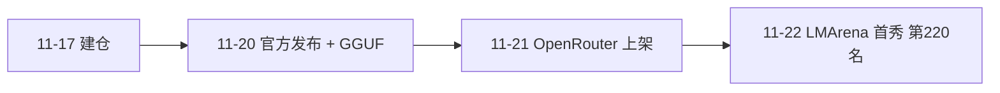

# AI 大模型周榜 · 2026.11.18–11.24

这一周 LMArena 的总榜像被按了暂停：前 20 名的名次一条没变，前 80 名里有 58 条与上一份快照完全一致，唯一的新条目落在第 220 名。11 月 18 日到 24 日这个窗口，真正的动静在开源侧——一个参数不大的 Inkling 2 Mini 冲上了 Hugging Face 趋势第一。先看另一套口径的能力指数，再回到 LMArena 的读数。

## 1. 能力指数 TOP30

::: warning 口径

下面这张图是另一套东西：Artificial Analysis 的 Intelligence Index，把十来项评测合成一个 0–100 的分数。它和后文 LMArena 的 Elo 不可换算，也不能放进一句话里比大小，两个榜各自纵向读。

:::

开头先看图。这张榜衡量的是固定评测集上的综合表现，和社区盲投出来的 Elo 是两种采样方式，只用来做横向的构成对照。

四条对照观察：

**头部构成**：前三名是 Anthropic 的 Claude Fable 5.2（64.77）、OpenAI 的 GPT-6.2 Astra（62.19）、Google 的 Gemini 4 Neon（61.55），三家各占一位。前十名里 Google 四席、Anthropic 三席、OpenAI 三席。Neon 是这一周才进这张榜的：OpenRouter 上它的报价 11 月 18 日才上架，和它出现在榜上的时间对得上。

**中国厂商密度**：前 30 名里中国厂商 11 席，排位最高的是第 12 的 Kimi K3.1 Pro（46.55）。前十名里没有中国模型，第 27 的 JoyAI-VL-Preview 国家列没映射到，未计入这 11 席。

**开源最高位**：能查到开放权重仓库的有 11 个，最靠前的是第 12 的 Kimi K3.1 Pro；再往下断了一截——第 18 的 Tencent Hy4（34.57）、第 19 的 DeepSeek V4.1 Flash 1017（32.40）、第 20 的 GLM-5.3（31.55）。从 46.55 到 34.57 中间空了 12 分。

**梯队落差**：前十名都在 50 分以上，第 10 的 Gemini 4 Argon 是 50.51。前 30 里最大的一道坎在第 14 的 Qwen4 Max（42.79）和第 15 的 Claude Haiku 5.5（36.54）之间，差 6.25 分；第 11 到第 12 也隔了 3.38 分（Muse Wonder Full 49.93 → Kimi K3.1 Pro 46.55）。榜尾第 30 是 MiMo-V2.6-Flash，26.83 分。

图上两个前提要交代：同一个模型的不同推理档位只取最高分，所以分数不代表默认调用的表现；带 `*` 的是 AA 标注的估算值，表示部分评测项缺样本。图上的"截至"写的是 11 月 25 日，比本文的数据窗口多一天。

## 2. 本期速览

- **分数最高**：Gemini 4 Carbon (High)，1,538.9 分，4,255 票，领先第二的 Argon 11.2 分。
- **投票最多**：Claude Opus 4.6 的 88,895 票（第 12 名）；前 20 名合计 763,060 票，其中 Anthropic 占九席。
- **厂商分布**：前 20 名里 Anthropic 9 席、Google 6 席、Meta 3 席，阿里与小米各 1 席；前 50 名里 Anthropic 与 Google 各 13 席，Meta 5 席，阿里、智谱、OpenAI 各 4 席，中国厂商合计 15 席。

| 排名 | 模型 | 厂商 | Elo | 周变化 | 投票数 | 上期 |
| --- | --- | --- | --- | --- | --- | --- |
| 1 | Gemini 4 Carbon (High) | Google | 1,538.9 | -0.4 | 4,255 | #1 |
| 2 | Gemini 4 Argon (High) | Google | 1,527.7 | +0.1 | 28,856 | #2 |
| 3 | Gemini 4 Neon (High) | Google | 1,522.9 | -0.7 | 5,611 | #3 |
| 4 | Claude Opus 5.5 (High) | Anthropic | 1,514.1 | +1.3 | 18,959 | #4 |
| 5 | Claude Fable 5.1 (Max) | Anthropic | 1,511.8 | -0.7 | 22,920 | #5 |
| 6 | Claude Opus 5 (Max) | Anthropic | 1,506.2 | -0.2 | 35,495 | #6 |
| 7 | Muse Wonder (Max) | Meta | 1,503.7 | +0.3 | 17,102 | #7 |
| 8 | Claude Opus 5 (High) | Anthropic | 1,502.2 | -0.1 | 73,350 | #8 |
| 9 | Gemini 4 Hydrogen (High) | Google | 1,502.1 | +0.4 | 4,737 | #9 |
| 10 | Claude Opus 4.6 (High) | Anthropic | 1,501.5 | 持平 | 84,109 | #10 |
| 11 | Gemini 3.8 Flash (High) | Google | 1,500.9 | +0.6 | 76,031 | #11 |
| 12 | Claude Opus 4.6 | Anthropic | 1,496.8 | +0.1 | 88,895 | #12 |
| 13 | Muse Spark 1.3 (Max) | Meta | 1,492.9 | -0.7 | 31,093 | #13 |
| 14 | MiMo-V2.6-Pro | Xiaomi | 1,492.9 | +0.2 | 4,047 | #14 |
| 15 | Claude Fable 5 (High) | Anthropic | 1,491.8 | -0.1 | 45,277 | #15 |
| 16 | Claude Opus 4.7 (High) | Anthropic | 1,489.8 | -0.1 | 64,030 | #16 |
| 17 | Gemini 3.7 Flash (High) | Google | 1,489.1 | -0.2 | 33,059 | #17 |
| 18 | Qwen3.8-Max | Alibaba | 1,484.9 | -0.4 | 41,147 | #18 |
| 19 | Muse Spark 1.2 (xHigh) | Meta | 1,483.5 | -0.5 | 18,973 | #19 |
| 20 | Claude Opus 4.7 | Anthropic | 1,483.4 | 持平 | 65,114 | #20 |

表里的"周变化"和"上期"按相邻两次发布计算：11 月 19 日 → 11 月 22 日，中间只隔三天[^snap]。

## 3. 总榜变动

### 3.1 头部变化

前 20 名的名次一条没变，分数变化全在 ±1.3 分以内（最大的是 Claude Opus 5.5 (High) 的 +1.3，其次是 Neon 和 Fable 5.1 (Max) 的 -0.7）。Carbon 1,538.9 领先 Argon 11.2 分，但它的 95% 区间是 1,529.3 到 1,548.4（±9.56），下界只比 Argon 的 1,527.7 高 1.6 分——这个"第一"仍压在误差线边上。

三天的窗口看不出趋势，把时间轴往前拉到 11 月 18 日，这一周唯一真实的位移在这里：Gemini 4 Neon 从 1,529.7 掉到 1,522.9（-6.8），第 2 的位置被 Argon 接走（1,528.6 → 1,527.7，几乎没动）。Neon 不是被追上，是自己掉了 6.8 分；它的票数同期从 3,885 涨到 5,611。

第 8 到第 10 名还是挤在一起：Opus 5 (High) 1,502.2、Hydrogen 1,502.1、Opus 4.6 (High) 1,501.5，三条差 0.7 分，而三条的票数分别是 73,350、4,737、84,109。票数差二十倍、分数差不到 1 分，这种排名谁上谁下都正常。

### 3.2 中段换手

这一期前 80 名的最大位移只有 2 位，58 个条目名次与上期完全一致。前 80 名里没有新条目——新进榜的 Inkling 2 Mini 落在第 220 名，第 220 名之后的条目因此各下移一位。

**上升**

| 本期 | 模型 | 上期 | Elo | 变化 | 投票数 |
| --- | --- | --- | --- | --- | --- |
| #26 | Gemini 3.5 Flash (Medium) | ~~#27~~ | 1,477.7 | 持平 | 46,115 |
| #35 | GLM-5.2 (Max) | ~~#36~~ | 1,469.5 | 持平 | 53,923 |
| #68 | Kimi K2.5 (Thinking) | ~~#69~~ | 1,444.7 | 持平 | 73,597 |
| #75 | ERNIE-5.0-Preview (1203) | ~~#77~~ | 1,442.6 | +0.3 | 9,738 |
| #80 | Hy3 | ~~#82~~ | 1,440.2 | +1.2 | 16,292 |

**下降**

| 本期 | 模型 | 上期 | Elo | 变化 | 投票数 |
| --- | --- | --- | --- | --- | --- |
| #27 | Claude Fable 5.2 (Max) | ~~#26~~ | 1,477.2 | -1.1 | 5,842 |
| #30 | GLM-5.3 (Max) | ~~#28~~ | 1,474.6 | -0.8 | 35,486 |
| #65 | GPT-6.1 Sol (Max) | ~~#63~~ | 1,445.7 | -0.8 | 16,525 |
| #70 | DeepSeek-V4-Pro (High, 20260813) | ~~#68~~ | 1,444.6 | -0.2 | 9,529 |
| #76 | GPT-5.1 (High) | ~~#74~~ | 1,442.5 | -0.1 | 41,354 |

上升的五条里有三条分数完全没动，纯粹是别人挪动让出的位置；Hy3 的 +1.2 和 ERNIE 的 +0.3 也在噪声里——前 20 名的区间半宽中位数是 4.72 分，一分多的变化撑不起"上升"这个说法。下降侧唯一值得看一眼的是 Claude Fable 5.2 (Max)：它从第 26 掉到 27，分数 -1.1，票数只有 5,842，是这一段里样本最薄的。

### 3.3 新条目辨析

这一期总榜 427 个条目，比上期多 1 个，没有一个条目掉出去。唯一的新条目是 Inkling 2 Mini：第 220 名，1,343.7 分，1,793 票，Apache 2.0，厂商列写的是 `thinky`（Hugging Face 上是 Thinking Machines Lab）。

做了两遍核对：归一化后 `inkling-2-mini` 在上一份快照里没有记录，去掉推理档位再查一遍也没有。四处数据能对上——Hugging Face 上 `thinkingmachines/Inkling-2-Mini` 仓库 11 月 17 日建好，11 月 20 日官方博客发布，同一天 unsloth 的 GGUF 版本上线，OpenRouter 11 月 21 日上架（每百万 token $0.07/$0.30，100 万上下文），11 月 22 日的快照里它第一次出现在 LMArena。时间线是连着的：

不过它是这一家里最小的一档。同门的 Inkling 2 Small 排第 158（1,402.8，2,682 票），Inkling 排第 72（1,444.0，55,011 票）。Inkling 2 Mini 的 1,793 票对应区间 1,329.3 到 1,358.1（±14.4），下一份快照里挪几十名都不奇怪。

::: tip 辨析

"新条目"和"新模型"是两件事。老模型换标识、补测、拆分档位，都会以新条目出现；反过来，条目掉出榜单也不代表下线，收录门槛和投票节奏都会影响去留。这一期只有一条新条目，四处交叉印证都指向真发布，才敢写成"新模型"。

:::

## 4. 分项榜

四个方向的快照日期并不相同：文本分榜是 11 月 22 日，网页生成 11 月 23 日，文生图 11 月 20 日，视觉 11 月 19 日，图像编辑停在 11 月 17 日。每段都标了日期。**不同类别的分数不能横向比较**——编码榜的 1,563.4 和网页生成榜的 1,821.7 是两条不同的刻度。

### 4.1 编码与网页生成

编码分榜（11 月 22 日）：Carbon 1,563.4 第一（1,059 票），Neon 1,555.0（1,320 票）、Opus 5.5 (High) 1,542.8（4,152 票）、Argon 1,540.2（6,727 票）、MiMo-V2.6-Pro 1,534.6（1,087 票）跟在后面。Carbon 领先 8.4 分，票数却只有 Argon 的六分之一。

网页生成榜（11 月 23 日）第一是 Claude Fable 5.2 (xHigh) 1,821.7（2,159 票），第二 Opus 5.5 (Max) 1,820.4（5,121 票），只差 1.3 分。后面是 Sonnet 5.5 (xHigh) 1,772.6、Carbon 1,769.0、Neon (xHigh) 1,765.3。

子榜的读数更碎。HTML 子榜换了头：GPT-6.2 Sol (Max) 1,851.0（384 票）第一，GPT-6.2 Astra (Max) 1,849.1（339 票）第二，Neon (xHigh) 1,805.0（396 票）第三。React 子榜还是 Anthropic 的地盘：Fable 5.2 (xHigh) 1,883.7、Opus 5.5 (Max) 1,873.8、Sonnet 5.5 (xHigh) 1,819.3。HTML 榜首只有 384 票，名次可以看，别当成稳固的排序。

### 4.2 中文与数学

中文榜（11 月 22 日）第一还是 Hydrogen，1,630.6，票数只有 345；Carbon 1,616.3（424 票）第二，Argon 1,609.3（2,380 票）第三，Neon 1,591.0（438 票）第四，Fable 5.1 (Max) 1,585.7（1,804 票）第五。前四里有三条票数不到 500，榜首和第四差 39.6 分，差距看着大，样本都薄。

数学榜（11 月 22 日）Argon 1,544.5 第一（1,486 票），Neon 1,543.7 第二（216 票），只差 0.9 分，而 Neon 的票数是 Argon 的七分之一。Fable 5.1 (Max) 1,533.8 第三，Opus 5 (High) 和 Opus 5 (Max) 以 1,531.7、1,530.9 排在第四、第五。

### 4.3 视觉与文生图

视觉总榜（11 月 19 日）前五全是 Anthropic：Fable 5 (High) 1,325.0（15,449 票）、Fable 5.1 (Max) 1,322.0（7,185 票）、Opus 5.5 (High) 1,321.8（5,903 票）、Opus 4.7 1,317.4（24,930 票）、Opus 5 (High) 1,317.3（19,229 票）。前三差 3.2 分。

文生图榜（11 月 20 日）前五里 OpenAI 占四席：GPT-Image-2.5 Sunburst 1,429.0（73,040 票）、2.6 Sunburst (Medium) 1,412.0（7,168 票）、2.5 Flare 1,399.9（72,202 票）、微软 MAI-Image-2.7 1,384.5（4,485 票）、GPT-Image-2 (Medium) 1,381.6（112,925 票）。

图像编辑榜停在 11 月 17 日：Sunburst 1,518.6（140,743 票）、Flare 1,483.6（137,820 票）、2.6 Sunburst (Medium) 1,480.7（16,881 票）、MAI-Image-2.7 1,475.5（3,007 票）。

### 4.4 写作与指令遵循

创意写作榜（11 月 22 日）：Carbon 1,535.1（1,006 票）第一，Opus 5.5 (High) 1,532.5（4,561 票）第二，Argon 1,531.6（6,772 票）第三，Neon 1,521.2（1,226 票）第四，Fable 5.1 (Max) 1,515.1（5,251 票）第五。前三差 3.5 分。

指令遵循榜（11 月 22 日）Carbon 以 1,539.3 守第一，Argon 1,536.6、Neon 1,535.1 跟在后面，三条差 4.2 分；第四是 Opus 5.5 (High) 1,533.4，第五是 Fable 5.1 (Max) 1,521.8。

## 5. 开源侧热度

`trendingScore` 是近期相对热度，不等于累计影响力；`downloads` 是 30 天口径。两个数放一起，才看得出一个仓库是"这周在涨"还是"一直很大"。

### 5.1 模型

| 模型 | 趋势分 | 喜欢 | 30 天下载 | 类型 | 创建日 |
| --- | --- | --- | --- | --- | --- |
| thinkingmachines/Inkling-2-Mini | 1,224 | 5,747 | 69,042 | 图文对话 | 11-17 |
| unsloth/Inkling-2-Mini-GGUF | 1,079 | 1,240 | 1,913,407 | 图文对话 | 11-20 |
| inworld/voice-isolator | 620 | 808 | 12,733 | 音频转音频 | 11-14 |
| AtomicChat/Inkling-2-Mini-Uncensored-GGUF | 429 | 736 | 573,775 | 图文对话 | 11-20 |
| harness-hub/Qwen3.8-27B-pi-adapted | 326 | 1,066 | 3,529 | 图文对话 | 11-16 |
| higurashi-ai/Haru-4B | 234 | 973 | 9,575 | 音频转音频 | 11-12 |
| tencent/Hy4-flash | 230 | 677 | 9,167 | 图文对话 | 11-17 |
| SulphurAI/Sulphur-3 | 229 | 892 | 160,965 | 未标注 | 10-31 |
| apple/FastFrames-L | 196 | 594 | 0 | 文生视频 | 11-16 |
| apple/DepthPro2 | 187 | 1,186 | 0 | 深度估计 | 11-03 |

三点读表：

- 前四里三个是同一个模型的仓库。官方仓库 5,747 喜欢、趋势 1,224，unsloth 的 GGUF 版本 191 万下载、趋势 1,079，连去审查版本也有 57 万下载。这是这一周唯一成规模的热度。
- 热度第一不等于下载第一。Inkling 2 Mini 官方仓库 30 天下载 6.9 万，只有 GGUF 版本的 1/28——量化版本才是真正被人拉去跑的那份。
- apple 的两个仓库 30 天下载都是 0，趋势分却排进前十。这类刚发布、还没被镜像和统计到的仓库，看趋势比看下载有意义。

### 5.2 数据集与 Space

数据集前五：`Vyber07/cyber-security`（342）、`Angais/pixel-art-atlas-1.4m`（41）、`nvidia/USDCraft-10K`（31）、`nvidia/simready-assets`（28）、`google/physical-engineerings-last-exam`（26）。第一名的 1,659 喜欢、3.5 万下载都是累计量，趋势分比第二名高出一个数量级。

Space 前五：`JCisHERE/wan2-2-i2v-v3`（190）、`MiniMaxAI/minimax-h3-image`（123）、`huggingface/moe-blogpost`（111）、`Lakonik/pi-H3`（102）、`joelniklaus/harness-leaderboard`（92）。视频演示和榜单面板占了大半，和上周的结构基本一样。

## 6. 价格与上下文

OpenRouter 这一期返回 470 条记录，剔掉 8 条负价占位（`openrouter/auto` 一类），有效报价 462 条：448 个付费、14 个免费。

### 6.1 本周新增

窗口内新上架 6 条记录，其中 1 条是 batch 变体，主条目 5 个：

| 模型 | 上架 | 上下文 | 输入价 | 输出价 |
| --- | --- | --- | --- | --- |
| google/gemini-4-neon | 11-18 | 1,048,576 | $3.00 | $15.00 |
| mistralai/pixtral-large-2502 | 11-20 | 128,000 | $2.00 | $6.00 |
| radixark/daisyrose-27b | 11-21 | 262,144 | $0.15 | $1.88 |
| thinkingmachines/inkling-2-mini | 11-21 | 1,048,576 | $0.07 | $0.30 |
| xiaomi/mimo-v2.6-flash-mopd | 11-23 | 1,048,576 | $0.15 | $0.42 |

价格一律是每百万 token 的美元价。batch 变体是 Neon 的半价副本（$1.50/$7.50）。五个主条目里三个在 100 万上下文，两个便宜得离谱：Inkling 2 Mini 的输出价 $0.30，是这期付费报价里最低的一档。

### 6.2 价格分层

付费模型的输出价中位数是每百万 token **$2.23**，区间从 $0.03（`mistralai/mistral-nemo`）到 $180（`openai/gpt-5.5-pro`、`openai/gpt-5.4-pro`）。

| 输出价（每百万 token） | 条目数 |
| --- | --- |
| < $0.5 | 95 |
| $0.5–2 | 113 |
| $2–5 | 81 |
| $5–15 | 105 |
| ≥ $15 | 54 |

支持 100 万以上上下文的 213 条，占付费报价的 47.5%；上下文长度的中位数是 50 万。14 个免费条目里有 8 个也支持 100 万以上——百万上下文已经从卖点变成默认配置。

## 7. 本周发布

**Google** 这周的发布偏产品和接口：11 月 18 日把 Gemini App 下放到内存更低的 Android 设备；11 月 19 日在 Gemini API 里加了工具检索（Tool Retrieval）；11 月 23 日讲 Google 搜索的个性化改造；11 月 24 日一篇是 Gemini 与 Golden State 球队的合作案例。模型侧没有新的旗舰发布，和主榜"零变动"对得上。

**OpenAI** 的重心在研究和评测：11 月 20 日发布 MedChemBench，用来评估模型在药物化学上的判断；同一天谈了怎么应对对抗蒸馏；11 月 23 日与 Cisco 联合推出 Shirudo；11 月 24 日两篇，一篇讲 GPT-6 系列在蛋白质设计上的表现，一篇讲用 Astra 搜索遥远行星。这周 OpenRouter 上没有新的 OpenAI 报价，AA 榜上 GPT-6.2 Astra 的分数只从 62.14 挪到 62.19。

**Hugging Face** 这边动作最多：11 月 18 日有 DaisyRose-27B（讲后训练效率）、Rumble-2-Flash（0.5B 的开源语音模型，40 多种语言），还有一篇 180B 参数塞进 32GB 内存的 MoE 推理实践；11 月 20 日发布 Inkling 2 Mini，同一天上线 harness adapters；11 月 23 日发了一篇怎么搭建和维护 agent 评测的教程。

Inkling 2 Mini 是这周唯一能在三处数据里互相对上的发布：HF 趋势第一（1,224）、OpenRouter 11 月 21 日上架（$0.07/$0.30）、11 月 22 日的 LMArena 快照里第一次上榜（第 220）。发布、上架、上榜三个动作挤在六天里。

**其他**：OpenRouter 11 月 21 日还上了 `radixark/daisyrose-27b`（$0.15/$1.88，256K 上下文），11 月 23 日上了 `xiaomi/mimo-v2.6-flash-mopd`（$0.15/$0.42，100 万上下文）。这两条只有接口记录，没找到对应的官方发布页，不当成"已确认发布"写。

## 8. 本期观察

**主榜进入零变动周，原因是没有新输入。** 前 20 名名次一条没变，前 80 名 58 条完全一致，最大位移 2 位。第 7 节的发布清单里没有新旗舰——Google、OpenAI 这周发的是接口、评测和合作，不是模型。榜单稳住不是模型变强了，是这周没有新选手进来。

**开源的重心从"打榜"转向"能装下"。** Inkling 2 Mini 在 AA 榜上根本进不了前 30（同门 Small 是第 21，30.68），在 LMArena 也只排第 220；但它在 HF 趋势第一、GGUF 版本五天 191 万下载、输出价 $0.30。分数和热度在这一档完全脱钩，用户要的是能在本地跑起来的小模型。

**百万上下文正在变成默认配置。** 448 条付费报价里 213 条（47.5%）支持 100 万以上，中位数 50 万；这周新上架的 5 个主条目里 3 个在 100 万级，最便宜的那条输出价 $0.30。

**中国厂商卡在第二梯队。** LMArena 前 50 名里中国厂商 15 席，AA 前 30 名里 11 席，但两张榜的前十都没有中国模型。最高位是 Kimi K3.1 Pro：AA 第 12（46.55），LMArena 上同门的 K3.1 Pro (Max) 只排第 45（1,458.9）。同一个模型在两套采样里差出 33 个名次，正好说明这两张榜测的不是一回事。

## 9. 数据说明

LMArena 是一个匿名对战平台：同一个问题给两个模型，用户投票选更好的那个，再用 Bradley-Terry 模型把胜负折算成 Elo 分数。所以它测的是"人类偏好"，不是标准答案正确率。

**Elo 怎么读**：分数是相对刻度，只有同一条目在不同快照之间的变化、或者同一张榜内的名次有意义。1,538 分和 1,471 分之间差的是一段相对强度，不是 67% 的能力。不同分榜的刻度也不同（编码榜 1,563 分和网页生成榜 1,822 分不能放一起比），这是本文反复提醒"不能跨类别比较"的原因。

**票数怎么读**：票越多，区间越窄。这一期 Carbon 4,255 票对应 ±9.56 分，Claude Opus 4.6 (High) 84,109 票对应 ±3.2 分。前 20 名的区间半宽中位数是 4.72 分——名次差一两而分数差不到 5 分的，别当成"超越"。

**榜单偏向什么**：匿名对战偏向开放式对话、写作、常识问答这类"一眼能看出好坏"的任务；编码、长文档、工具调用要看分项榜，而分项榜收录门槛更高、更新也更慢。这一期视觉榜停在 11 月 19 日，图像编辑榜停在 11 月 17 日。

**时间窗怎么切**：本文覆盖 2026 年 11 月 18 日 00:00 到 11 月 25 日 00:00，正文里的"周变化"取窗口内最后一个快照（11 月 22 日）和它的上一份（11 月 19 日），两份之间只隔三天[^snap]。所以表里的分数变化比一整周要小，第 3.1 节另外拿 11 月 18 日的快照补了一次跨度更长的对照。

**命名口径**：LMArena 在 2026 年 10 月 15 日前后把模型标识从 slug 改成展示名，切换期两种格式混装。本文所有环比都先做归一化（转小写、括号转后缀、`4.6` 与 `4-6` 对齐），再用去掉推理档位的键复核一遍，避免把改名当成新模型[^name]。

最后交代一句：第 1 节的能力指数是另一套口径（Artificial Analysis 把十来项评测合成 0–100 分），和 Elo 不能换算，也不能放进同一句话里比大小。

[^snap]: 快照日期取自 LMArena 的 `leaderboard_publish_date`，是数据截止日，不等于页面发布时间。这一期窗口内有 11 月 19 日和 11 月 22 日两份快照。

[^name]: 归一化后仍可能撞名，例如 `Command R` 与 `Command R+`（加号被剥离）；这类条目按名次保留更靠前的一条。
