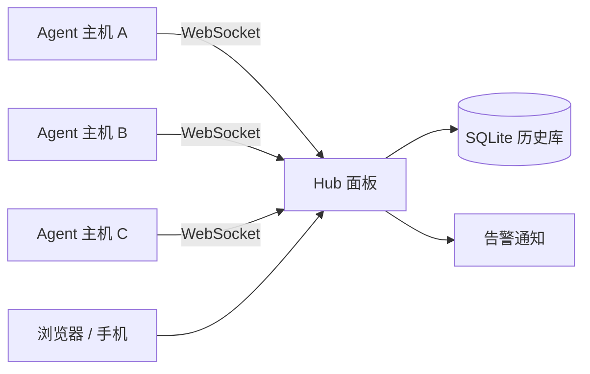

# Beszel：轻量自托管服务器监控面板

服务器一多，问题就从"哪台机器挂了"变成"我到底有几台机器、谁在吃内存"。我把内网几台主机和一台公网机器接进同一个 Beszel 面板，hub 只占十几 MB 内存，CPU、内存、磁盘、容器、温度、systemd 服务都能看到。这篇写清楚它适合什么场景、服务端和客户端怎么跑、客户端怎么管。

## 1. 它是干什么的

Beszel 是一个开源的自托管服务器监控工具，用 Go 写的。它的结构很传统：**hub + agent**。hub 是网页面板，负责存历史数据、算告警；agent 装在被监控的机器上，采集指标后上报给 hub。

它不像 Netdata 那样把单机指标挖到极致，也不像 Prometheus 那样要求你先搭一套存储和 Grafana。它盯的是运维日常最常看的那几项：CPU、内存、磁盘、带宽、负载、温度、容器、systemd 服务，再加一个够用的告警。



数据落在 hub 内嵌的 PocketBase（SQLite）里，所以没有额外数据库要维护。默认保留粒度是 1 分钟数据存 1 小时、10 分钟数据存 12 小时、20 分钟存 1 天、2 小时存 7 天、8 小时存 30 天。

## 2. 为什么选它

同类工具我大致分成三类：指标极细的（Netdata）、需要自己搭全套的（Prometheus + Grafana + exporter）、只管"活着没"的（Uptime Kuma）。Beszel 的位置在中间，选它主要是这几点：

- **资源占用小**：hub 实测十几 MB，agent 五六 MB，1 核 2G 的小机器也跑得动
- **部署简单**：hub 一个 compose 文件，agent 一个静态二进制或一个容器
- **自带历史与图表**：不用另配时序库，装完就有时长区间的曲线
- **容器开箱即用**：挂上 `docker.sock` 就有每个容器的 CPU / 内存 / 网络曲线
- **备份简单**：hub 的数据就是一个目录，拷走即可

## 3. 核心优势

### 3.1 轻量零依赖

hub 是单个容器，agent 是单个静态二进制，不需要 Python、Node、JVM 之类运行时。对外只暴露面板一个端口，其余全走出站连接。

### 3.2 一个面板多机

首页把所有机器排成一张表，能按 CPU、内存、磁盘、网络排序，一眼看出谁在异常。


*总览页：所有系统实时排序，磁盘超过阈值会变黄*

### 3.3 容器级视角

宿主总量之外，还能按容器拆开看。对跑了一堆 compose 服务的机器来说，这个功能比总量曲线有用得多——至少能一眼看出是哪个容器在吃内存。

### 3.4 客户端只出不进

agent 默认主动用 WebSocket 连 hub。内网机器、NAT 后面的机器都不用开任何入站端口，也不用做端口映射。同内网也可以切到 SSH 模式（hub 主动连 agent 的 45876），但跨网段时 WebSocket 更省事。

## 4. 服务端部署

### 4.1 容器方式

```yaml
services:
  beszel:
    image: henrygd/beszel:0.21.2
    container_name: beszel
    restart: unless-stopped
    environment:
      APP_URL: https://monitor.example.com
      TZ: Asia/Shanghai
      USER_EMAIL: admin@example.com
      USER_PASSWORD: change-me-please
    ports:
      - "127.0.0.1:8090:8090"
    volumes:
      - /data/beszel:/beszel_data
```

`USER_EMAIL` 和 `USER_PASSWORD` 只在首次启动、库里还没有用户时生效，用来创建管理员。端口建议只绑 `127.0.0.1` 或用内网地址，对外交给反向代理。

也可以用二进制：`./beszel serve --http 0.0.0.0:8090`，数据目录同样是 `beszel_data`。

### 4.2 反代注意点

面板用 WebSocket 和事件流推实时数据，反代要带升级头，并且把读超时放大，否则首页会一直转圈。

```nginx
location / {
    proxy_pass http://127.0.0.1:8090;
    proxy_http_version 1.1;
    proxy_set_header Upgrade $http_upgrade;
    proxy_set_header Connection "upgrade";
    proxy_set_header Host $host;
    proxy_set_header X-Forwarded-Proto $scheme;
    proxy_read_timeout 360s;
    client_max_body_size 10M;
}
```

配完记得把 `APP_URL` 改成实际访问地址，告警里的链接和 agent 配置生成都会用到它。

## 5. 客户端部署

### 5.1 二进制方式

从 Release 下载对应架构的压缩包，解出一个静态二进制，然后在目标机器上建一个专用用户。

```bash
useradd --system --home-dir /var/lib/beszel-agent --shell /sbin/nologin beszel
install -d -m 0750 -o beszel -g beszel /var/lib/beszel-agent
install -m 0755 beszel-agent /usr/local/bin/beszel-agent
```

配置写进环境文件（权限 640，属主 root:beszel）：

```bash
KEY="ssh-ed25519 AAAA...面板上显示的公钥"
TOKEN="面板生成的 token"
HUB_URL="https://monitor.example.com"
SYSTEM_NAME="prod-web-01"
DISABLE_SSH="true"
LISTEN="127.0.0.1:45876"
```

systemd 单元：

```ini
[Unit]
Description=Beszel Agent
After=network-online.target
Wants=network-online.target

[Service]
Type=simple
User=beszel
Group=beszel
EnvironmentFile=/etc/beszel-agent.env
ExecStart=/usr/local/bin/beszel-agent
Restart=on-failure
RestartSec=5
StateDirectory=beszel-agent
NoNewPrivileges=yes
ProtectSystem=strict
ProtectHome=read-only

[Install]
WantedBy=multi-user.target
```

```bash
systemctl daemon-reload && systemctl enable --now beszel-agent
```

**为什么更推荐二进制**：容器里看不到宿主的 systemd 单元，温度和 S.M.A.R.T. 也基本拿不到。换成二进制后，同一台机器上报的 systemd 服务从 0 变成几十上百个，根分区识别也从容器里的挂载点变成真正的 `/`。

### 5.2 容器方式

```yaml
services:
  beszel-agent:
    image: henrygd/beszel-agent:0.21.2
    restart: unless-stopped
    network_mode: host
    volumes:
      - /var/run/docker.sock:/var/run/docker.sock:ro
      - /data/beszel-agent:/var/lib/beszel-agent
    environment:
      KEY: "ssh-ed25519 AAAA...公钥"
      TOKEN: "面板生成的 token"
      HUB_URL: "https://monitor.example.com"
      SYSTEM_NAME: "prod-docker-01"
```

`network_mode: host` 是为了拿到宿主网卡统计；挂 `docker.sock` 才有容器列表。以非 root 跑的话，温度和 S.M.A.R.T. 通常没有权限。

### 5.3 两种连接方式

| 方式 | 谁发起 | 适用场景 | 端口要求 |
|---|---|---|---|
| WebSocket | agent → hub | 内网、NAT、跨公网 | agent 只需出站 443 |
| SSH | hub → agent | 同一内网、hub 能直达 | agent 开 45876 |

批量部署时我一般固定用 WebSocket，并在 agent 侧设 `DISABLE_SSH=true`，少一个暴露面。

## 6. 客户端管理

### 6.1 接入新主机

两种路径：点右上角 **Add System** 手动填名字和地址，弹窗里会给公钥和 token；或者用 **通用 token（universal token）**——在设置里生成一个长期有效的 token，所有 agent 都用它连，第一次连上自动建系统，不用提前在面板里登记。

这个设计对批量部署很友好：命令行装完 agent，面板里就自动出现一台新机器。agent 的身份由 `fingerprint` 文件决定，删掉它再连会被当成一台新机器，所以别乱删。

### 6.2 面板与详情

单机详情页按卡片排布：CPU、内存、磁盘、磁盘 IO、带宽是基础项，装了 docker 会有容器 CPU / 内存 / 网络，有传感器会有温度，有 GPU 会有显存与功耗。


*单机详情：上半是宿主，右侧是容器维度，下面是温度与 GPU*

时间区间可以切 1 小时、12 小时、24 小时、1 周、30 天，排查"昨天下午为什么卡"够用了。

### 6.3 监控项一览

- **基础**：CPU、内存、swap、负载、根分区与额外挂载点、磁盘 IO、网络带宽
- **容器**：每个容器的 CPU、内存、网络，以及镜像是否有更新
- **systemd**：指定服务的运行状态与最近日志
- **硬件**：温度、风扇、S.M.A.R.T.、电池、ZFS 池、Btrfs
- **GPU**：NVIDIA / AMD / Intel（需要对应的 agent 镜像或宿主驱动）
- **网络探针**：定时 ping 目标，记录延迟、丢包、证书到期时间
- **心跳**：向外部服务定时发心跳，用来监控 Beszel 自己是不是挂了

### 6.4 告警与通知

阈值按系统单独设置，CPU、内存、磁盘、带宽、温度、负载、离线都能配。通知渠道相当全：Telegram、Slack、Discord、企业微信、飞书、Bark、Gotify、ntfy、Pushover、PagerDuty 系的 OpsGenie，以及通用 webhook。


*通知设置：一个系统可以挂多个渠道，按告警类型分*

磁盘 S.M.A.R.T. 报失败会自动触发通知，不用自己写规则。这一点对机械盘多的机器挺实用。

### 6.5 日常维护

- **升级**：hub 改镜像 tag 重建；agent 换二进制后 `systemctl restart`，二进制方式也支持 `beszel-agent update`
- **备份**：整目录备份 `/data/beszel`，注意 `id_ed25519`（hub 私钥）和 `data.db` 要成对，私钥丢了旧系统的 SSH 认证就失效
- **多用户**：可以建只读角色，给同事看面板但不让改配置
- **对外集成**：有 REST API，官方文档也列了第三方的桌面端和手机端 App

## 7. 实践建议

### 7.1 S.M.A.R.T. 权限

非 root 的 agent 读不到磁盘健康，这是最常见的"功能没数据"问题。除了加 `CAP_SYS_RAWIO` 和 `CAP_SYS_ADMIN`，还要处理设备权限——NVMe 控制器设备默认是 `crw------- root:root`，得让 `disk` 组可读。

::: warning 注意

只加 capability 不够，设备文件权限挡在前面；只加 `disk` 组也不够，NVMe 的透传命令要 `CAP_SYS_ADMIN`。两件事都要做。

:::

```ini
# systemd 单元
SupplementaryGroups=disk
AmbientCapabilities=CAP_SYS_RAWIO CAP_SYS_ADMIN
CapabilityBoundingSet=CAP_SYS_RAWIO CAP_SYS_ADMIN
```

```bash
# udev 规则：让 NVMe 字符设备对 disk 组可读
cat > /etc/udev/rules.d/99-smartctl-disk-group.rules <<'EOF'
KERNEL=="nvme[0-9]*", GROUP="disk", MODE="0660"
EOF
udevadm control --reload-rules && udevadm trigger
```

改完重启 agent，面板上就能看到温度、通电时长、磨损百分比。

### 7.2 容器还是二进制

要容器统计就挂 `docker.sock`，两种方式都行；但想要 systemd 服务、温度、S.M.A.R.T.、真实根分区，二进制明显更完整。我的做法是：能装二进制就装二进制，容器只当临时方案。

### 7.3 别把面板裸奔

面板本身有登录和角色，但终究是暴露在公网的管理界面。建议只绑内网或本地，前面套一层带 HTTPS 的反向代理，有条件再加一层访问控制。

## 8. 小结

Beszel 适合这样的场景：手上有几台到几十台自托管主机，想知道它们的资源水位、容器状态和磁盘健康，但不想为此搭一套 Prometheus。装起来十分钟，跑起来几十 MB，日常够用。

它不解决的问题也很明确：日志检索（上 Loki）、链路追踪（上 APM）、超大规模指标（上 Prometheus + VictoriaMetrics）。把这几个边界分清楚，用起来就不会别扭。
