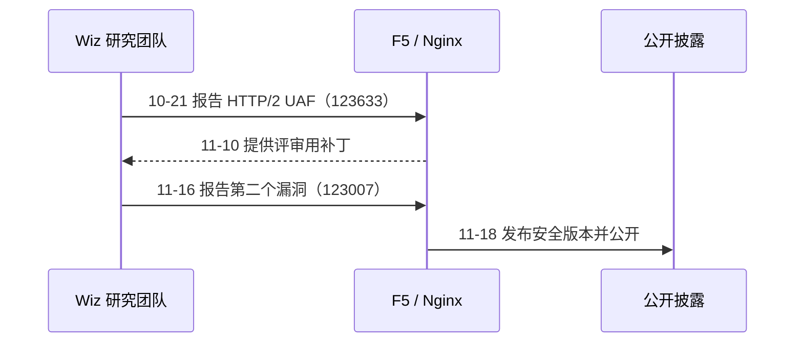

# Hacker News 周榜解读 · 2026.11.13–11.19

这周的 Hacker News 有点反常：分数最高的不是模型发布，而是一所大学把课堂录像免费放上了 YouTube；评论最多的也不是什么争议，而是星舰夹住飞船时的那阵欢呼。十五个话题里，安全事件和大模型发布各占四席，剩下的被一次云故障、两门动手课和一篇「把设备从云上抢回来」的长文分掉了。

## 1. 本期速览

- **分数最高**：卡内基梅隆把整学期的计算机课程免费搬上 YouTube，2,366 分，也是本期唯一破两千的条目。
- **讨论最激烈**：星舰第 15 次飞行的回收画面，1,493 条评论——分数排第二，情绪浓度第一。
- **主题分布**：安全与隐私 4 条、大模型 4 条、开源与教育 3 条、硬件与动手实践 3 条、云服务故障 1 条。

| 排名 | 标题 | 分数 | 评论数 | 来源 |
| --- | --- | --- | --- | --- |
| 1 | [Carnegie Mellon is putting computer science courses on YouTube for free](https://www.cs.cmu.edu/learn/) | 2,366 | 331 | cs.cmu.edu |
| 2 | [SpaceX catches the Starship to end Flight 15](https://www.spacex.com/launches/starship-flight-15) | 1,761 | 1,493 | spacex.com |
| 3 | [Unauthenticated remote code execution in Nginx](https://www.wiz.io/blog/nginx-http2-rce-vulnerabilities) | 1,480 | 636 | wiz.io |
| 4 | [GPT‑6.2 Astra and Sol](https://openai.com/index/introducing-gpt-6-2-astra-sol/) | 1,345 | 861 | openai.com |
| 5 | [All AI-generated code should be Open Source](https://jakub.jankiewicz.org/blog/ai-code-open-source/) | 1,285 | 672 | jakub.jankiewicz.org |
| 6 | [Service degradation on Microsoft 365](https://status.cloud.microsoft/) | 1,176 | 996 | status.cloud.microsoft |
| 7 | [Java4Shell: RCE in OpenJDK when processing Base64](https://calif.io/java4shell/) | 1,176 | 329 | calif.io |
| 8 | [Gemini 4 Neon](https://blog.google/innovation-and-ai/models-and-research/gemini-models/gemini-4-neon/) | 1,010 | 758 | blog.google |
| 9 | [Lovable apps expose passport details and more than 200K private messages](https://www.crissyfield.de/research/lovable-en/) | 1,007 | 382 | crissyfield.de |
| 10 | [LibreOffice actually works 365 days a year](https://twitter.com/LibreOffice/status/2121205272479998268) | 959 | 294 | twitter.com |
| 11 | [How to make almost anything](https://pub.cba.mit.edu/863.26/site/) | 916 | 149 | pub.cba.mit.edu |
| 12 | [Rust 1.100](https://blog.rust-lang.org/2026/11/12/Rust-1.100.0/) | 905 | 321 | blog.rust-lang.org |
| 13 | [Quad9's withdrawal from France: A canary in the coal mine](https://blog.cloudflare.com/quad9-withdrawal-from-france/) | 902 | 455 | blog.cloudflare.com |
| 14 | [Qwen4-Max](https://qwen.ai/blog?id=qwen4-max) | 882 | 485 | qwen.ai |
| 15 | [Reverse engineering my Coway air purifier to ditch the cloud](https://scottjg.com/posts/2026-11-11-reverse-engineering-my-coway-air-purifier-to-ditch-the-cloud/) | 804 | 225 | scottjg.com |

## 2. 焦点讨论

### 2.1 CMU 免费公开计算机课

[Carnegie Mellon is putting computer science courses on YouTube for free](https://www.cs.cmu.edu/learn/) ｜ 本期 #1 ｜ 2,366 分 ｜ 331 条评论 ｜ 来源：cs.cmu.edu

**一所顶级计算机学院把在校课程原样录下来免费放出，评论区争的却是「这波能撑多久」。**

项目叫 CS Learn，上线第一批就是八个整学期的课：10-605 大规模数据机器学习、15-110 计算原理、17-214 软件构造、15-442 机器学习系统、17-635 软件架构、11-768 AI Agents、17-645 生产环境机器学习等，本周每天首播一门，明年一月还有第二批。项目负责人 Phillip Compeau 在评论区亲自解释了做法：几位学生写工具把录制、切分、上传的流程自动化，小团队也能快速产出，但每节课仍有人工复核；他也主动提了一句「MIT 二十五年前就到这儿了」。

真正有信息量的是老用户的回忆：2000 年代末那一波大学公开课，后来因为视频没有字幕、在部分司法辖区构成无障碍合规风险，被学校成批下架。所以这次评论区问得最多的不是「课好不好」，而是「这次会不会又因为某个合规问题撤掉」。

### 2.2 星舰的第 15 次飞行

[SpaceX catches the Starship to end Flight 15](https://www.spacex.com/launches/starship-flight-15) ｜ 本期 #2 ｜ 1,761 分 ｜ 1,493 条评论 ｜ 来源：spacex.com

**第 15 次飞行，发射塔的机械臂接住了飞船本体；助推器这次没有回收。**

评论区的绝大多数是情绪——「这就是我想要的未来」「画面完美得像渲染」。少数技术观察更有意思：把隔热瓦和舵面减到极致、把回收复杂度整个搬到地面，只有在一个允许「随便提蠢主意」的组织里才敢这么设计；也有人补了一句，这次只接住了上面级，助推器没接，双回收才算是真正的里程碑。还有人认真算可复用经济学，认为带着返航燃料上天等于把火箭方程又交了一遍税。原文站点在当前网络下被 CDN 挡住，本条依据标题与讨论区整理[^spacex]。

### 2.3 Nginx 的双 RCE

[Unauthenticated remote code execution in Nginx](https://www.wiz.io/blog/nginx-http2-rce-vulnerabilities) ｜ 本期 #3 ｜ 1,480 分 ｜ 636 条评论 ｜ 来源：wiz.io

**两个 9.2 分的未授权 RCE 同时落在全球最流行的 Web 服务器上，五个团队各自独立发现。**

CVE-2026-123007 是 HTTP/2 流控里的内存破坏，只要开着 HTTP/2 就可能在默认配置下被利用，影响范围一直回溯到 2015 年的 1.9.5；CVE-2026-123633 是 HTTP/2 反向代理场景下的释放后使用。修复版本是 1.30.7 稳定版与 1.31.9 主线版，Plus 也同步发了补丁，同批还修了另外八个中高危问题。Wiz 给出的数字很刺眼：Nginx 背后是两亿两千五百万个站点。

评论区第一反应是「多久会被打」，第二反应是「补丁都没发就披露这么细？」——不过半小时内新版本就出来了，质疑也随之变成调侃。最有意思的一条是：五个研究团队同时撞上同一个洞，这大概创了「漏洞撞车」的纪录。来不及升级的话，临时关掉 HTTP/2 是官方给的缓解手段。

### 2.4 GPT-6.2 的两个型号

[GPT‑6.2 Astra and Sol](https://openai.com/index/introducing-gpt-6-2-astra-sol/) ｜ 本期 #4 ｜ 1,345 分 ｜ 861 条评论 ｜ 来源：openai.com

**一次发两个型号，Astra 更大、Sol 更便宜，发布重点从「刷分」换成了「把一个任务做完要多少钱」。**

评论区把这套叙事接住了：有人说这是第一次有厂商把「任务完成成本」摆到台面上，而不是硬堆分数；也有人直接贴出自己的账——同样的编程基准，6.2-sol 比 6.1-sol 高三个多点，单价只贵三分钱，但把推理档位调低一档可能更划算。另一条线索是横向比较：有 Google 员工在评论里追问，为什么公布的科学基准里没有 Gemini 4 Carbon 的成绩。

唱反调的同样具体：基准好看、真开工就崩，最后还得回去用 Claude 收拾残局；以及 Astra 和 Sol 在日常任务里到底差多少，很多人表示「感觉不出来」。原文对非浏览器请求返回 403，本条依据标题与讨论区整理[^openai]。

### 2.5 AI 代码该不该开源

[All AI-generated code should be Open Source](https://jakub.jankiewicz.org/blog/ai-code-open-source/) ｜ 本期 #5 ｜ 1,285 分 ｜ 672 条评论 ｜ 来源：jakub.jankiewicz.org

**作者的主张很直接：模型是拿开源代码和 CC 授权的问答喂出来的，产出却闭源，这叫许可证洗白。**

文章的逻辑分两段：一是来源，训练语料里大量是 GPL 代码和署名要求明确的 Stack Overflow 内容；二是法律，美国版权局长期坚持非人类作者不给版权，那 AI 产出的代码本就不该被某家公司圈起来，干脆用开源许可证或 CC0 放出来。

评论区的反驳也一刀见血：「如果 AI 生成的代码根本不可版权，那给它挂一个开源许可证是空的。」紧接着有人搬出判例——Doe v. GitHub 认定模型输出不继承训练素材的开源许可，Thaler v. Perlmutter 认定纯 AI 产出拿不到版权，两条合起来正好与作者的推论相反。第三条反对意见更现实：代码可以无限生成时，「开源」保护的是谁？也有做垂直领域项目的开发者承认，自己大部分项目都开源，唯独那个靠多年行业经验堆出来的不开——他也不知道该怎么和解。

### 2.6 微软 365 的一次长故障

[Service degradation on Microsoft 365](https://status.cloud.microsoft/) ｜ 本期 #6 ｜ 1,176 分 ｜ 996 条评论 ｜ 来源：status.cloud.microsoft

**Exchange Online 在美洲区大面积不可用，而官方的状态页自己也慢到打不开。**

微软在状态页里的说法是：暂停所有部署和配置变更，排查与本次事件的关联；负载升高不是~~流量暴涨~~，而是大量服务器「意外不可用」，把压力挤到了剩下的机器上。评论区有人把状态页的更新整段贴了过来，算是替打不开页面的人做了镜像；也有人只留了三个字「整个组织都挂了」。

这类帖子的评论区通常没什么技术含量，但每次的形态几乎一样：故障本身、状态页不可用、大家转而去第三方探测站。一位用户说得很直白——「说实话我有点享受这种故障」，因为只有这时候才会有人认真问一句：我们到底有多依赖一个自己控制不了的开关。

### 2.7 Java 的 Base64 也出事

[Java4Shell: RCE in OpenJDK when processing Base64](https://calif.io/java4shell/) ｜ 本期 #7 ｜ 1,176 分 ｜ 329 条评论 ｜ 来源：calif.io

**OpenJDK 为了加速 Base64 解码手写的 AVX-512 汇编，把边界算错了一个字节，于是有了一个 9.2 分的 RCE。**

触发只需要 64 个 `A` 加一个 `=`（JDK 17 上要 128 个），解码器会算出负的输出长度，从偏移 48 开始写 64 字节，把 50 字节的缓冲区直接写穿；利用得当可以像 Heartbleed 那样读内存，也能走到远程代码执行。影响 OpenJDK 17.0.6 及以后，Corretto、Temurin、Zulu、Liberica、GraalVM 这些基于它的发行版全在内，前提是 x86-64 且 CPU 支持 AVX-512。

这条的讨论比另外两个安全帖冷静得多：有人先问「攻击面到底在哪」，有人直接贴出上游修复提交，Semgrep 顺手放了检测脚本；也有人怀疑这是不是被夸大的 DoS。研究者的落点其实在另一处——这段优化只对极少数真的要解码海量数据的应用有意义，却被打包发给了所有人，出问题时大家一起承担。

::: warning 缓解

在 x86-64 主机上启动 JVM 时加 `-XX:-UseBASE64Intrinsics`，或加 `-XX:UseAVX=2` 关掉 AVX-512 路径。这两个参数在 ARM 上不被识别，会导致 JVM 起不来。

:::

### 2.8 Gemini 4 的命名混乱

[Gemini 4 Neon](https://blog.google/innovation-and-ai/models-and-research/gemini-models/gemini-4-neon/) ｜ 本期 #8 ｜ 1,010 分 ｜ 758 条评论 ｜ 来源：blog.google

**Neon 接的是 3.1 Pro 的位置，但这一期讨论最多的是「到底谁比谁强」。**

从评论里拼出来的信息是：Neon 属于中大型档，官方引用的第三方评测里 Vals Index 排第二（70.9%），法律检索和税务 Agent 两个专项排第一；Artificial Analysis 的智能分与 GPT-6.2 Sol 相当，但价格明显更贵，延迟是它的强项。也有人说，这是 3.1 Pro 等了很久的正式继任者。

命名是吐槽的富矿：这个月已经出了 Hydrogen、Carbon、Argon、Neon 四个名字，原子序数和价格、能力都对不上——氖（10）比碳（14）便宜，却又比氢强。于是评论区的共识变成了「选模型靠轮盘赌」，另一条高赞干脆按档位把三家厂商排了张表，把 Astra/Sol、Fable/Opus、Hydrogen/Neon/Carbon 一一对位。原文链接现在已经 404，本条依据标题与讨论区整理[^google]。

### 2.9 Lovable 应用的数据裸奔

[Lovable apps expose passport details and more than 200K private messages](https://www.crissyfield.de/research/lovable-en/) ｜ 本期 #9 ｜ 1,007 分 ｜ 382 条评论 ｜ 来源：crissyfield.de

**研究团队扫了十五万多个 Lovable 项目，发现大量数据库不用登录就能读。**

样本来自 Common Crawl，覆盖 2025 年 12 月到 2026 年 9 月的 159,041 个项目，其中 34,545 个用了 Supabase；24,664 个站点在页面刚加载时就把数据库记录吐了出来。再补几次只读请求，7,403 个站点（30%）的表里能翻到邮箱。案例包括：德国一个生活论坛泄露八万多份含姓名、生日、性别的资料和二十多万条聊天记录；票务和餐饮记录里夹着支付信息与票号；最严重的一例有一千多份身份证件，护照号、有效期、国籍俱全；还有一家服务商把二十八万封客户邮件放在了公开可读的地方。

作者在评论区现身，说这篇两周前投过一次没火。讨论很快从「某个平台不安全」转向更普遍的问题：这类应用把攻击门槛降到了「打开浏览器看网络请求」，而平台的市场话术暗示「安全我们帮你搞定」，条款里却把责任全推给用户。有人补了一刀：上周 Railway 被打，攻击者据称就是拿这类模型批量找洞的。

### 2.10 LibreOffice 的 365 梗

[LibreOffice actually works 365 days a year](https://twitter.com/LibreOffice/status/2121205272479998268) ｜ 本期 #10 ｜ 959 分 ｜ 294 条评论 ｜ 来源：twitter.com

**一条借「365」玩双关的推文，正好撞上微软 365 故障那一周。**

评论区没有被梗带跑，反而认真做起了产品对比：有人说离线版 Office 一直是好的，最新的 2024 版这周还在更新，把云故障算到 Office 头上并不公平；也有人承认自己每次打开 LibreOffice 都觉得「微软是不是付钱让它保持这么丑」。最有建设性的一条类比是 Blender——同样是开源替代品，靠一次彻底的界面重做翻身，而 LibreOffice 和 GIMP 都还没走完那一步。

至于「文档最后还得导成 docx 才有人要」这种抱怨，基本没人反驳。推文所在平台无法直接抓取，本条依据标题与讨论区整理[^twitter]。

### 2.11 MIT 的万能制造课

[How to make almost anything](https://pub.cba.mit.edu/863.26/site/) ｜ 本期 #11 ｜ 916 分 ｜ 149 条评论 ｜ 来源：pub.cba.mit.edu

**MIT 那门著名的 MAS.863，今年的课程表被贴上了 HN。**

课表是一周一个主题：CAD、项目管理与数控切割、嵌入式、3D 扫描与打印、电路设计与生产、数控加工、输入输出设备、机械与机器设计，最后是系统集成和期末项目。每节课配一次 recitation，连「版本控制」「EDA」「调试」「边缘 AI」这种具体工具链都单列出来。

评论区的分歧很典型：一派认为这课「什么都讲一点」，CAD 一门就够干一辈子，一节课列五十个工具等于什么都没教；另一派反驳说，先知道「世界上有 Y 这个办法」本身就有价值，将来遇到问题时至少知道该往哪查。还有人借机怀念 TechShop 那类创客空间——机器就在手边，理论和手感才能对上。

### 2.12 Rust 1.100 的里程碑

[Rust 1.100](https://blog.rust-lang.org/2026/11/12/Rust-1.100.0/) ｜ 本期 #12 ｜ 905 分 ｜ 321 条评论 ｜ 来源：blog.rust-lang.org

**版本号凑到整数只是巧合，内容确实是一次大版本。**

最受关注的是 never type：`!` 现在可以写在任何位置，`Infallible` 直接变成它的别名；代价是一次破坏性变更——2024 之前的 edition 里，never type 的 fallback 从 `()` 改成了 `!`。同批稳定的还有 allocator API 的核心部分，`Vec` 和 `Box` 可以用自定义分配器了，这也是「Allocators 1.0」的地基；此外还有 DropGuard、零大小类型相关的改进、Cargo 报告未使用依赖、缓存冲突修复，以及按发布时间设置「依赖冷却」的 min-publish-age。

评论区有人问「不是应该等官方博客再投吗」，结果发现这就是官方博客。真正有温度的是一条实际收益：有人这几天正在修 arena 泄漏，之前只能用第三方 crate 模拟 `Vec::new_in`，1.100 一发布就能删依赖了。至于「还是想要稳定 ABI」的呼声，和往年一样，没人指望短期内实现。

### 2.13 Quad9 退出法国

[Quad9's withdrawal from France: A canary in the coal mine](https://blog.cloudflare.com/quad9-withdrawal-from-france/) ｜ 本期 #13 ｜ 902 分 ｜ 455 条评论 ｜ 来源：blog.cloudflare.com

**瑞士非营利的公共 DNS 服务商撤出法国，因为法院按天罚它没封锁「侵权域名」。**

Cloudflare 把这件事定性为「DNS 层强制封锁」的危险先例：Quad9 要么接受每天都在累积的罚款，要么放弃整个法国市场，它选了后者。文章的核心论点是，把版权执法塞进解析器这一层，等于让基础设施替内容判断背锅，而误伤会波及所有用户。

评论区一半在谈「互联网的巴尔干化」，一半在质疑 Cloudflare 的立场——「你自己也在给不配合的浏览器设墙，讲开放互联网有点讽刺」。还有一位英国用户的视角值得记下来：在他的环境里，多数人不会把这类监管看成警钟，反而觉得这是政府终于管住了互联网。同一件事，两种政治直觉，这也是这条能吵到四百多层的原因。

### 2.14 Qwen4-Max 的价签

[Qwen4-Max](https://qwen.ai/blog?id=qwen4-max) ｜ 本期 #14 ｜ 882 分 ｜ 485 条评论 ｜ 来源：qwen.ai

**参数堆到 2.4T，发布重点却落在「单任务成本降了 58%」。**

据多家媒体报道，Qwen4-Max 于 11 月 16 日发布，MoE 架构、百万级上下文，API 定价为输入每百万 token 1.5 美元、输出 4.5 美元，缓存命中降到 0.075 美元，官方口径是单任务平均费用比上一代降了约六成[^qwen]。

评论区的怀疑很具体：有人贴出 Artificial Analysis 的数据，说它 43 分、平均成本 3.27 美元，而 GPT-6.1 Sol（medium）46 分只要 0.36 美元——「效率叙事」在第三方口径下并不成立。另一群人关心的是完全不同的东西：这次没有开放权重，Flash 和 27B 什么时候来？「开源模型的追赶速度是不是在变慢」，比这一代的分数更让他们焦虑。

### 2.15 把空气净化器抢回本地

[Reverse engineering my Coway air purifier to ditch the cloud](https://scottjg.com/posts/2026-11-11-reverse-engineering-my-coway-air-purifier-to-ditch-the-cloud/) ｜ 本期 #15 ｜ 804 分 ｜ 225 条评论 ｜ 来源：scottjg.com

**为了在 Apple Home 里一键关灯顺便关风扇，他把厂商云整个绕过了。**

原本的路子是社区写的 Home Assistant 集成：伪装成手机 App，轮询 Coway 云再下发指令。问题是这朵云一年要坏一两次——限流封禁、App 改名（IoCare 改成 IoCare+）导致集成重写、页面结构微调导致抓取失效、账号被封几周。今年十月 eMudhra 根证书私钥参数太弱，等于短期人人手握一张可信根证书，加上设备硬编码根证书又不做证书固定，中间人这条路突然变得可行。

真正的转折在最后：他让 AI 从蓝牙抓包和反编译的安卓 App 里复原出配网协议——20 分钟干完原本要几天的手工活——然后发现配网载荷里自带 `caUrl` 和 `certSvrUrl` 两个字段。既然载荷是自己发的，把这两个地址指向自己的服务器就行，中间人都省了。现在风扇直连 Home Assistant，再桥到 Apple Home，「Good Night」终于能一次关完。评论区因此在讨论另一件事：这类设备的安全模型，到底还剩多少。

## 3. 本期观察

**安全话题的重心从「怎么打」移到了「为什么这段代码还在」。** Nginx 和 Java4Shell 两条加起来两千多分，讨论最热的不是利用链，而是披露时序和代码裁剪：一个问「补丁没发为什么先披露」，一个问「只服务少数人的优化凭什么发给所有人」。五支团队同时撞洞这件事，也说明这类基础设施被审视的密度已经到了什么程度。

**大模型发布进入了价签竞争。** GPT-6.2、Gemini 4 Neon、Qwen4-Max 三条都在谈每百万 token 和每任务成本，跑分退到第二位；而三家的命名体系同时失控——元素周期表、Astra/Sol、Max/Flash，用户只能靠第三方榜单和社区整理的表来对位。参数增长的故事讲不动了，价格和延迟成了新的战场。

**生成太便宜，审查没跟上。** 「AI 代码该不该开源」和「Lovable 应用数据裸奔」看似一个谈许可、一个谈安全，其实是同一枚硬币：当生成成本趋近于零，许可证和访问控制这些「慢工序」就成了唯一的约束，而它们恰恰最容易被跳过。

**对云的依赖出现了反向运动。** 微软 365 挂掉、状态页也跟着挂；同周一篇长文在讲怎么把设备从厂商云里抢回本地，一条推文拿「离线也能用」当卖点；再加上 Quad9 因为监管退出一个国家。三种不同形态的同一件事：把开关交到别人手里，代价会在最不方便的时候出现。

## 4. 数据说明

**Hacker News 是什么。** 它是 Y Combinator 运营的技术社区，排序由投票和时间衰减共同决定。榜单里的「分数」就是社区投票的净结果，代表「这群人觉得值得一看」，不等于客观重要性；同一件事放在别的圈子里，分数可能完全不同。

**它天然偏向什么。** 工程实践、安全、开源项目、大模型，以及「我自己动手解决了某个问题」的帖子，在这里最容易起量。纯时政、医疗、消费促销和公司八卦通常分数不低但讨论质量差，所以本期按惯例剔除了这类条目，只保留技术/产品向的前十五名。分数门槛设在 300 分——本期过线的有一百多条，取前十五刚好卡在 804 分。

**评论数该怎么读。** 评论多不等于争议大。星舰那条一千四百多层，绝大部分是情绪表达；Nginx 只有六百多层，但每一层几乎都在谈技术。看争论要看「有没有人拿出反例」，而不是看楼层数。

**时间窗与收录。** 本期覆盖 11 月 13 日 00:00 到 11 月 20 日 00:00（UTC+8），也就是上周五到本周四这七天；同一链接被重复提交时只算一次，取讨论更集中的那条。

**本期的缺口。** 有四个来源的原文没能取到：SpaceX 的页面被 CDN 拦截、OpenAI 返回 403、Gemini 4 的链接已 404、LibreOffice 的推文所在平台不可抓取。这几条只依据标题和讨论区整理，判断都以评论区里确实出现的说法为限。

[^spacex]: 原文站点在当前网络环境下返回 Cloudflare 拦截页，本条仅依据标题与 Hacker News 讨论区内容整理。

[^openai]: openai.com 对非浏览器请求返回 403，本条依据标题与讨论区整理；讨论区提到系统卡链接当时尚未上线。

[^google]: blog.google 上该链接现已返回 404，本条依据标题与讨论区整理。

[^twitter]: 推文所在平台无法直接抓取，本条依据标题与讨论区整理。

[^qwen]: qwen.ai 的文章页由前端渲染，正文无法直接获取；参数与价格取自多家媒体报道，讨论点来自评论区。
